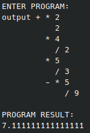

- WARNING: THIS PROJECT IS INCOMPLETE AND PRESENTS CRITICAL UNRESOLVED ISSUES.
- CURRENTLY IN INDEFINITE HIATUS; MIGHT GET SCRAPPED AND REWRITTEN FROM SCRATCH.

- Experimental interpreted programming language
- Purely functional, syntax entirely based on indentation
- Currently available features: only basic arithmetic and/or boolean expressions evaluation, and output
- Included flowcharts represent (in very simplified way) how the interpreter works
- How to use the shell:
  1) Execute "python3 ProLan.py"
  2) Write your ProLan command
  3) Press newline another time to signal the end of the command
  4) Your command will be executed
  (note: nothing will be shown unless you use "output" as your main command)
- Please refer to "ProLan manual.txt" to learn how to write ProLan

ProLan shell prompt usage example:

